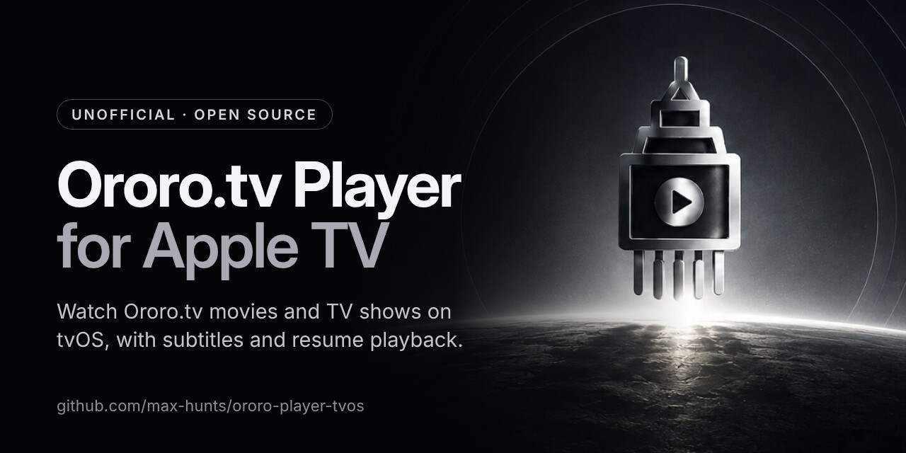

# Ororo.tv Player for Apple TV

An unofficial, open-source **Apple TV (tvOS) app for watching [Ororo.tv](https://ororo.tv/en)**
movies and TV shows. Sign in with your Ororo.tv account, browse and search the catalogue, watch
with English subtitles, and pick up where you left off.

[![CI][ci-badge]][ci-url]
[![Swift][swift-badge]][swift-url]
[![Platform][platform-badge]][platform-url]
[![License][mit-badge]][mit-url]

**Website:** [max-hunts.github.io/ororo-player-tvos](https://max-hunts.github.io/ororo-player-tvos/)



> This project is not affiliated with, endorsed by, or sponsored by Ororo.tv.
> You need your own Ororo.tv account to use it.

## Features

- [x] Movies and TV shows, with genre filters and sorting (popularity, rating, year, name, recently added).
- [x] Search across movies and shows.
- [x] English subtitles, in sync with playback.
- [x] Resume playing from where you stopped, or start over.
- [x] Favorites: press and hold a title to add it or reset its progress.
- [x] Playback quality picker: Auto, or a cap at 480p, 720p, 1080p or 4K.
- [x] English and Russian interface.
- [x] Sign in with your Ororo.tv account. Credentials stay in the Apple TV Keychain.

## Install on your Apple TV

Ororo.tv Player isn't on the App Store, so you build it onto your Apple TV from a Mac with Xcode.

You need:

- A Mac with Xcode (tested with Xcode 27)
- An Apple TV on tvOS 15 or later, on the same network as the Mac
- An Apple ID (a free one works)
- An Ororo.tv account

Steps:

1. Install Xcode from the Mac App Store and add your Apple ID under **Xcode › Settings › Accounts**.
2. Clone the repo:

   ```
   git clone https://github.com/max-hunts/ororo-player-tvos.git
   ```

3. Give Xcode your own signing team and bundle ID prefix:

   ```
   cp Config/Local.xcconfig.example Config/Local.xcconfig
   ```

   Then edit `Config/Local.xcconfig`. It is git-ignored, so your team ID stays out of commits.
4. Pair the Apple TV: on the Apple TV open **Settings › Remotes and Devices › Remote App and Devices**,
   then on the Mac open **Xcode › Window › Devices and Simulators**, select the Apple TV and enter the code it shows.
5. Open `Ororo-Player.xcworkspace` (always the workspace, never an individual project), select the
   `Ororo-Player-tvOS` scheme and your Apple TV, and press **Run**.
6. Sign in with your Ororo.tv account. Credentials are stored in the Keychain on the device and sent
   only to ororo.tv, as HTTP Basic auth over HTTPS.

Apps signed with a free Apple ID stop opening after 7 days; run it from Xcode again to renew.
A paid Apple Developer Program membership extends that to a year.

To try it without a device, pick an Apple TV simulator in step 5. The simulator needs no signing setup.

## FAQ

**Is this the official Ororo.tv app for Apple TV?**
No. It's an independent, open-source project and isn't affiliated with or endorsed by Ororo.tv.

**Is it on the App Store or TestFlight?**
No. You install it from a Mac with Xcode, as described above.

**Which Apple TV models does it run on?**
Any Apple TV on tvOS 15 or later: Apple TV HD and every Apple TV 4K.

**Does it work on iPhone or iPad?**
No, it's Apple TV only. The original project, [maxovtsin/ororo-tv-player](https://github.com/maxovtsin/ororo-tv-player),
also had an iOS app.

**Which subtitles are available?**
English for now. A subtitle language picker is on the roadmap.

## Roadmap

- [ ] Subtitle language picker.
- [ ] A queue for episodes.
- [ ] Let `GenericCollectionViewDataSource` show different kinds of cells on the same screen.

## Development

```
swiftlint lint --strict
xcodebuild test -workspace Ororo-Player.xcworkspace -scheme Ororo-KitTests \
  -destination 'platform=tvOS Simulator,name=Apple TV 4K (3rd generation)'
```

The app is written in pure Swift. The only third-party dependency is the
[Transitions](https://github.com/maxovtsin/Transitions) navigation library by Max Ovtsin, which ships
prebuilt as a committed `xcframework`, so a fresh clone builds without running Carthage.

The project website lives in [`docs/`](docs/) and is served by GitHub Pages.

See [CONTRIBUTING.md](CONTRIBUTING.md) for details and [CLAUDE.md](CLAUDE.md) for an
architecture overview.

## Credits

This app started as the tvOS target of [maxovtsin/ororo-tv-player](https://github.com/maxovtsin/ororo-tv-player)
by Max Ovtsin.

## License

**Ororo.tv Player** is released under the [MIT license](LICENSE).

[ci-badge]: ../../actions/workflows/ci.yml/badge.svg
[ci-url]: ../../actions/workflows/ci.yml
[swift-badge]: https://img.shields.io/badge/swift-5-orange.svg?style=flat
[swift-url]: https://swift.org
[platform-badge]: https://img.shields.io/badge/platform-tvOS%20%7C%20Apple%20TV-lightgrey.svg
[platform-url]: https://developer.apple.com/tvos/
[mit-badge]: https://img.shields.io/badge/License-MIT-blue.svg?style=flat
[mit-url]: LICENSE
